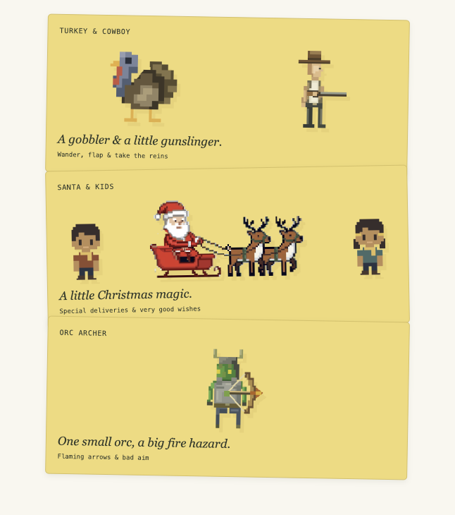

# Sidequest

### Your website. A little more mischief.

Tiny games. A very unserious JavaScript library.

Let pixel-art turkeys wander across your headings, send a little orc out to cause
trouble, or bring Santa and his sleigh to your page. Watch them go about their
business—or click a character and take the reins.



**No dependencies. No external artwork to load. Just a little joy.**

## Pick your sidequest

| Game | A little something extra |
| --- | --- |
| **Turkey & cowboy** | A gobbler & a little gunslinger. Turkeys wander, flap, and perch on your page while a cowboy patrols below. Take control, aim, and fire a charged shot. |
| **Santa & kids** | A little Christmas magic. Santa delivers presents to waiting children as pixel snow falls. Pilot the sleigh and toss a few gifts yourself. |
| **Orc archer** | One small orc, a big fire hazard. Send flaming arrows at your page and watch tiny fires flicker. The flames are decorative; your content stays intact. |

## Add a sidequest

Build the library with `npm run build`, then copy `dist/sidequest.js` alongside
your page. Place this before `</body>`:

```html
<button id="holiday-mode">Release the visitors</button>

<script src="./sidequest.js"></script>
<script>
  let game;
  const button = document.querySelector('#holiday-mode');

  button.addEventListener('click', () => {
    if (!game) game = Sidequest.start({ mode: 'turkeys' });
    else if (game.running) game.stop();
    else game.start();

    button.textContent = game.running
      ? 'Gather the visitors'
      : 'Release the visitors';
  });
</script>
```

Prefer modules? Import the built module and launch after the page body exists:

```js
import { start } from './dist/sidequest.mjs';

const game = start({ mode: 'santa' });

// Other adventures: 'turkeys' or 'orc'.
game.pause();
game.resume();
game.stop(); // Remove the scene and its listeners.
```

## Made to play along

- **Your page is the playground.** Characters use exposed text and painted edges
  as ledges, following them as the page scrolls.
- **Watch or play.** Click the cowboy or orc, move with **A / D**, aim with the
  mouse, and hold then release to fire. Santa flies with **W / A / S / D** and
  tosses charged presents. Press **Escape** to hand control back.
- **Starts when you say so.** Nothing mounts until you call `start()`. Keep it
  behind a button for visitors who want a little company.
- **A considerate guest.** Styles live in Shadow DOM, reduced-motion preferences
  are respected by default, and hidden tabs pause the action. During player
  control, game input takes over until you exit.
- **Bring your own soundtrack.** The library is silent. Optional callbacks let
  you add sounds; the demo includes a few.

## Try it locally

```sh
npm run dev
```

Open [the demo](http://localhost:4173/demo/), choose a game, and release the
visitors. No feeding required.

For customization, full controls, browser support, and integration details, see
the [integration guide](docs/guide.md) and [TypeScript API](src/sidequest.d.ts).

```sh
npm run build
npm test
```

Made for the joy of small, unnecessary things. [MIT licensed](LICENSE).
